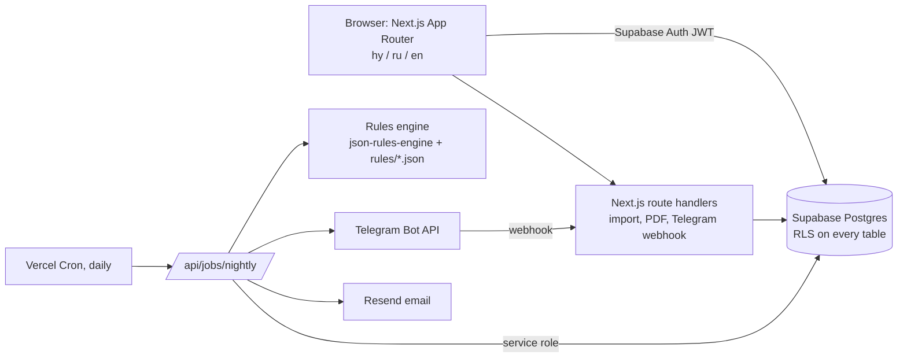
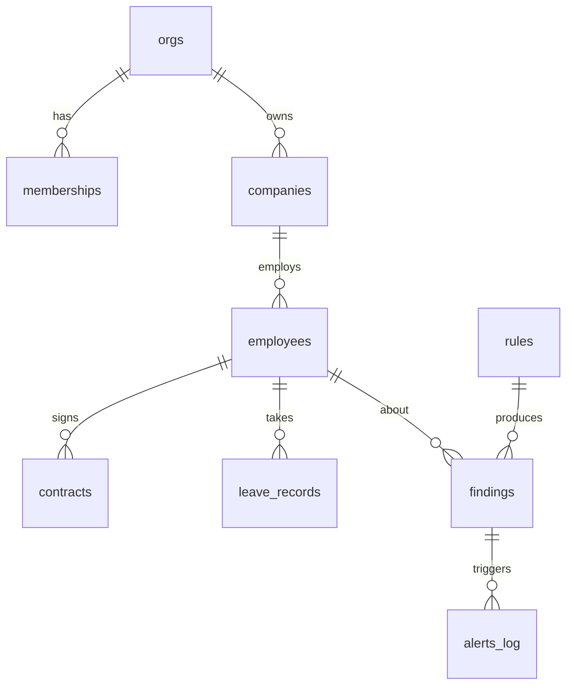

# Architecture

## Overview



**Stack:** Next.js 15 (App Router, TypeScript) on Vercel Hobby · Supabase (EU region) Postgres + Auth + Storage · json-rules-engine (ISC) · date-fns · zod · next-intl · @react-pdf/renderer + Noto Sans Armenian (OFL) · shadcn/ui + Tailwind · GSAP/Motion on the landing page only.

## Folder structure
```
rules/                     versioned rule JSON (source of truth for legal logic)
src/lib/rules/             engine: catalog (schema-validated), facts, engine, score + tests
src/app/[locale]/          UI routes (next-intl)
src/app/api/               route handlers: jobs/nightly, telegram/webhook, import, pdf
supabase/migrations/       SQL schema + RLS
supabase/tests/            plain-Postgres shim + cross-tenant attack tests (CI)
docs/                      PRD, rules matrix, plan, decisions, investor requests, gtm
```

## Rules engine
Legal thresholds live in JSON, date arithmetic lives in TypeScript.

1. **Facts** (`facts.ts`) turn raw rows into derived facts: `ageAtStart`, `daysUntilProbationEnd`, `probationOverrunDays(maxMonths)` and so on. Facts with parameters read their thresholds (3 months, 20/24 days, notice tiers) from the rule JSON, so changing a threshold means a new rule version, not a code change.
2. **Conditions** in each rule are standard json-rules-engine conditions over those facts.
3. **Severity:** `verified` → the declared severity; anything else → `advisory`.
4. **Determinism:** the output depends only on (rules, data, `asOf`). Results are sorted and there is no clock access inside the engine.
5. **Scope:** `contract` rules run per contract; `employee` rules run once per employee against the primary contract (latest active).

Rules are seeded into `public.rules (id, version)` on deploy, and every finding references the exact `(rule_id, rule_version)`.

## Data model
`orgs` → `memberships(user_id, org_id, role)` → `companies` → `employees` → `contracts`, `leave_records`; `findings`, `alerts_log`, `templates`, `audit_log`, `rules`.



**Data minimisation:** an employee row stores name, birth date (only needed for the minor check) and six-day-week. No passport numbers, addresses, salary or phone numbers.

## Security
- RLS on every table. Membership checks go through `security definer` helpers in a `private` schema (`is_member`, `can_edit`, `has_role`), using `(select auth.uid())` for per-statement caching.
- `org_id` is denormalised onto every row, and **composite foreign keys** `(parent_id, org_id)` make it impossible to attach a row to another tenant's parent, even with a forged `org_id`.
- Roles: `owner` (everything plus members plus audit), `accountant` (edit data, fix findings), `viewer` (read).
- `anon` has no table or function access. Orgs are created only through the `create_org()` RPC, which atomically makes the caller owner.
- Findings are written only by the service role (the nightly job). Users can change only `status`, enforced by trigger; the resolver and time are recorded.
- An audit trigger on all tenant tables writes to `audit_log`, which only owners can read and nobody can write directly.
- Verified by `supabase/tests/rls_cross_tenant.sql` (26 attack and permission checks) in CI.

## Nightly job
Vercel Hobby cron (once a day) calls `/api/jobs/nightly` with a secret. The job runs per company in batches: load data → `evaluateCompany` → upsert findings on `(rule_id, employee_id, contract_id)` → close findings no longer produced → send new red/advisory alerts → write `alerts_log`. On Mondays it sends the weekly digest. If Vercel limits bite, the fallback is Supabase `pg_cron` + `pg_net` calling the same endpoint.

## i18n
next-intl with locale prefix routing, `hy` as the default. Messages live in `messages/{hy,ru,en}.json`; rule titles come from the rule JSON. Fonts: Noto Sans Armenian plus Inter (Latin/Cyrillic) via `next/font`.

## PDF pipeline
@react-pdf/renderer in a Node route handler, with Noto Sans Armenian registered from a bundled TTF (OFL). Templates are JSON in the `templates` table (built-in rows have `org_id` null) rendered with employee and company data.
